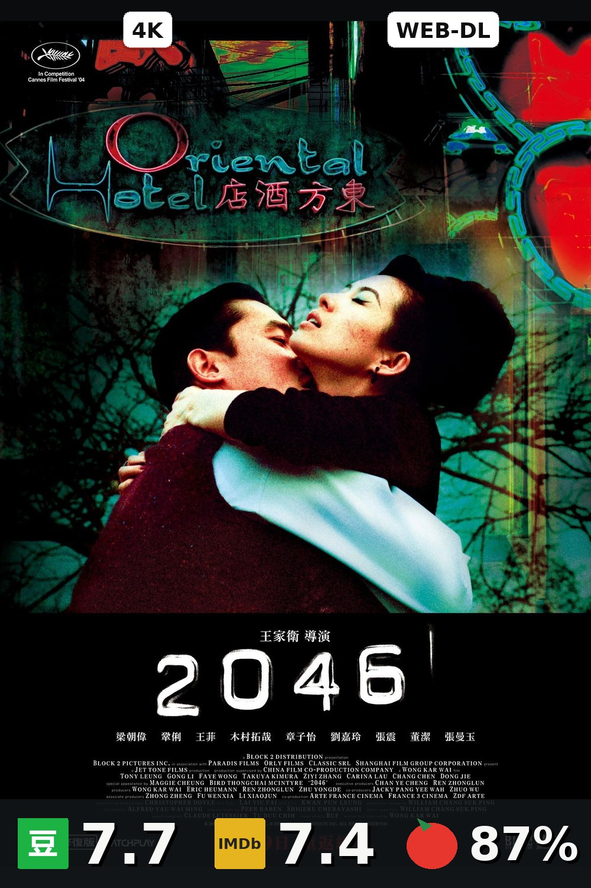

# Emby Poster Worker

给 Emby 的海报叠加**画质徽章**（4K / HDR / Dolby Vision / Atmos / 编码）和**三源评分栏**（豆瓣 / IMDb / 烂番茄），写回为该条目的封面。跑一次，整库海报统一成 2:3 的成品样式。

> **它会覆盖你 Emby 里的 Primary 海报。** 首次部署请先用 `DRY_RUN=true` 跑一遍，确认效果后再关闭。原图会自动缓存，控制台可逐条恢复。

## 效果预览

**渲染后的海报**——顶部画质徽章，底部三源评分条：

<p align="center">
  
</p>

**同一个条目，处理前后**——原图先缓存再叠加，重绘永远基于干净原图，不会越叠越厚：

<p align="center">
  
  
</p>

**从 4K 原盘到低清网络源都成立**——徽章按媒体流实际信息生成，缺失的评分按显示方案收起，不留空槽：

<p align="center">
  
  
  
  
  
</p>

**内置管理控制台**——纯静态页面，由 Worker 直接托管，不需要 Node、不需要数据库：

| 概览 | 影视库 | 海报样式 |
| --- | --- | --- |
|  |  |  |

## 快速开始

```bash
cp .env.example .env     # 填 EMBY_URL、EMBY_API_KEY、PUBLIC_BASE_URL
docker compose up -d --build
```

不想本地构建就用预构建镜像（amd64 + arm64），把 compose 里的 `build: .` 换成：

```yaml
image: ghcr.io/blackhumor66666/emby-poster-worker:latest
```

控制台在 `http://你的地址:8098`，初始密码见 `docker compose logs | grep -i bootstrap`。

**第一次务必先试运行**：把 `.env` 里的 `DRY_RUN` 改成 `true`（想先看一部片就同时设置 `ITEM_IDS`），启动后打开 `cache/rendered/` 里的 JPG 检查效果，满意再改回 `false`。

## 功能亮点

| 亮点 | 说明 |
| --- | --- |
| **画质徽章** | 分辨率、WEB-DL/BluRay/Remux 片源、HDR10 / Dolby Vision、Dolby / DTS-HD 音频、视频编码，全部从媒体流真实信息生成。剧集取全集最高画质 |
| **三源评分** | 豆瓣 + IMDb + 烂番茄。缺失的来源自动收栏，不留空槽；也可固定三栏用 `--` 占位 |
| **豆瓣分带身份校验** | 逐条核对标题 / 年份 / IMDb ID 一致才采信，不会把别的片的分贴上来；上游刷新期间评分短暂消失时连续确认 3 次才清除 |
| **永不叠加** | 原图永久缓存，重绘永远基于干净原图；控制台可对任何条目一键恢复原图 |
| **试运行模式** | `DRY_RUN=true` 完整渲染但不写 Emby、不保存状态，验收完关掉即可全库生效 |
| **内置控制台** | 概览统计、全库搜索、按问题类型筛选、批量重绘/恢复、评分覆盖、IMDb ID 绑定、样式实时预览。无 Node、无数据库 |
| **只处理你想处理的库** | 勾选指定影视库，其余库完全不读取、不渲染、不计失败；库 ID 变化时自动降级并告警，避免整库停摆 |
| **省心的自动化** | 每小时扫描新片、Webhook 入库即时渲染、原图定时打包备份、扫描失败推送告警、合集缺封面自动补齐 |
| **单容器交付** | 一个 Python 进程 + 两个依赖（Pillow、requests），无数据库、无外部服务 |

**刻意不做的事**：不改标题/简介/分类等元数据（除你手动确认的 IMDb、豆瓣 ID 绑定）；不抓豆瓣、不内置评分账号、不绕过任何数据源配额；不做「按客户端显示不同海报」——同一张图会被所有客户端复用，这是刻意取舍。

## 需要准备什么

1. **Emby 4.9+ 和一个 API Key**（读取媒体 + 修改图片权限）。
2. **`PUBLIC_BASE_URL`** 必须是 **Emby 容器能访问到** 的 Worker 地址，并包含实际映射端口。填错会「装好了但海报空白」。
3. **豆瓣分需要神医助手 Pro 的本地缓存**（可选）。没有它豆瓣列显示 `--`，IMDb / 烂番茄照常。挂载方式见 `.env.example` 的 `DOUBAN_CACHE_HOST_PATH`。

## 常用配置

| 变量 | 作用 |
| --- | --- |
| `DRY_RUN` | 试运行，只渲染不写回 |
| `ITEM_IDS` | 只处理指定条目，逗号分隔 |
| `LIBRARY_IDS` | 只处理指定影视库 |
| `RATING_DISPLAY_STRATEGY` | `compact` 自动收栏 / `fixed` 固定三栏 / `quality_only` 只留徽章 |
| `IMAGE_DELIVERY_MODE` | `url` 让 Emby 引用 Worker 图片（推荐）/ `upload` 直传 Emby / `dual` 两者都做 |
| `BACKUP_ENABLED` | 原图定时打包备份到独立卷 |
| `WEBHOOK_TOKEN` | 启用 Emby Webhook 即时渲染 |
| `ALERT_WEBHOOK_URL` | 扫描失败时推送告警 |

完整清单和逐项注释见 [`.env.example`](.env.example)。代理默认不需要；若必须走代理，记得把 Emby 地址加入 `NO_PROXY`。

## 常见问题

**发布新版本后，已部署的实例会自动更新吗？**
不会。Docker 镜像不会自动升级，这是刻意的——绘制规则变化可能触发全库重绘。更新用 `docker compose pull && docker compose up -d`；升级前建议看一眼 [CHANGELOG.md](CHANGELOG.md) 里 `RENDER_VERSION` 有没有变。

**发布者需要一直开着服务器吗？**
不需要。镜像由 GitHub Actions 构建并托管在 ghcr.io，使用者直接 pull，不依赖发布者的任何机器。

**豆瓣列全是 `--`？**
说明没有配置豆瓣缓存，属正常。见上面「需要准备什么」第 3 条。

**想恢复某张海报？**
控制台 → 影视库 → 选中条目 → 恢复原图。原图在 `cache/original/`。

**控制台初始密码？**
`docker compose logs | grep -i bootstrap`，首次登录后请立即修改。

## 开发

`app.py` 是组装根（HTTP 路由、扫描循环、Emby 访问），其余模块可独立导入，`tests/test_module_boundaries.py` 锁定依赖方向：

| 模块 | 职责 |
| --- | --- |
| `badges.py` | 从媒体元数据生成画质徽章 |
| `rendering.py` | 海报合成 |
| `render_queue.py` | 持久化单条队列（与整库扫描串行） |
| `douban_source.py` | 带身份校验的豆瓣缓存读取 |
| `rating_policy.py` / `rating_review.py` / `media_match.py` | 评分准确性守卫 |
| `storage.py` | 原子写入工具 |

```bash
pip install -r requirements-dev.txt
python -m unittest discover -s tests -t . -v
```

CI 在每次 push / PR 执行同一套测试，打 `v*` 标签时构建并推送镜像。改渲染规则请用同一素材做前后 MD5 对比。

## 许可

MIT。安全策略与使用风险见 [SECURITY.md](SECURITY.md)，变更记录见 [CHANGELOG.md](CHANGELOG.md)。
